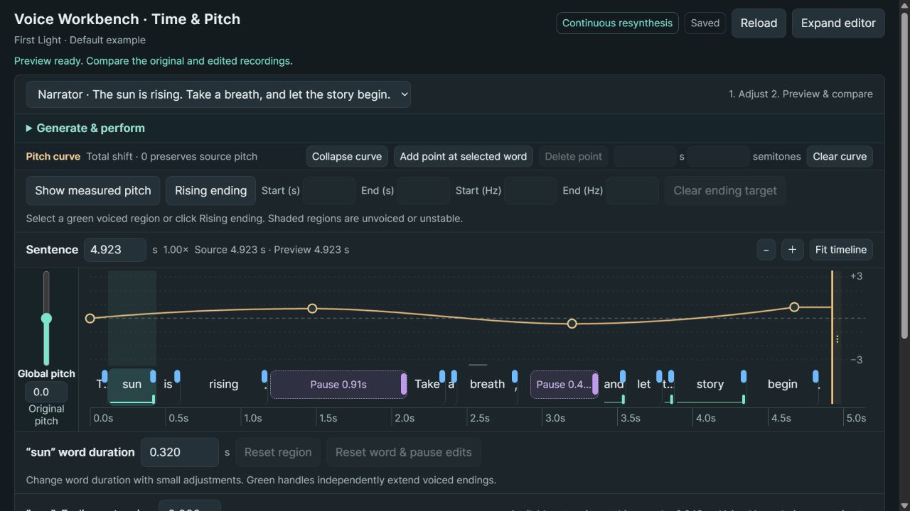
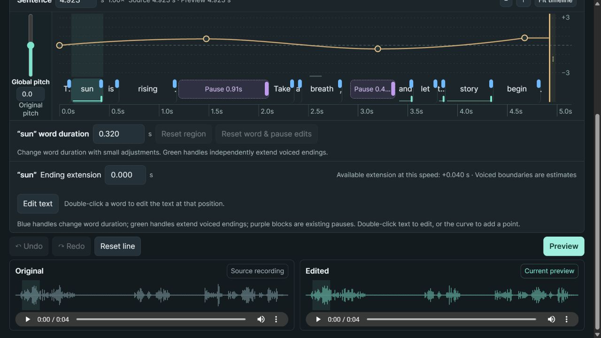

# ComfyUI Voice Workbench

A local, English-language workbench for generating speech and shaping its pitch, word duration, voiced endings and existing pauses. Edit a whole sentence, compare recordings, and return to an earlier take.



The editor runs as a ComfyUI bottom panel or a standalone local application. Both use the same editor and audio services.

## Quick start

Python 3.10 or newer is required. No model download is needed to open the bundled example and edit its audio.

```bash
git clone https://github.com/Enmani/ComfyUI-VoiceWorkbench.git
cd ComfyUI-VoiceWorkbench
python -m venv .venv
```

Activate the environment:

```powershell
# Windows PowerShell
.venv\Scripts\Activate.ps1
```

```bash
# Linux / macOS
source .venv/bin/activate
```

Then install the CPU dependencies and open the editor:

```bash
python -m pip install -r requirements.txt
python run.py
```

Open **http://127.0.0.1:8794/**. The **First Light** example loads automatically. On Windows, **Generate & perform → System voice → Generate take** also works with an installed English speech voice. System speech provides a quick start; it does not clone a voice or control emotion.

## ComfyUI installation

Clone this repository into `ComfyUI/custom_nodes/ComfyUI-VoiceWorkbench`. Install `requirements.txt` with the Python environment that starts ComfyUI, then restart ComfyUI.

For Windows portable ComfyUI, from its root directory:

```powershell
.\python_embeded\python.exe -m pip install -r .\ComfyUI\custom_nodes\ComfyUI-VoiceWorkbench\requirements.txt
```

Add **audio → Voice Workbench → Voice Workbench · Time & Pitch** and click **Open editor**. Leave `document_path` empty to use the default example. You can also load [the example workflow](examples/comfy-workflow.json). The **Voice Workbench** bottom tab provides the same editor.

## Try the default example

> The sun is rising. Take a breath, and let the story begin.

1. Play **Original**. Four preset pitch points are already visible.
2. Drag a gold point up or down, or use arrow keys on a selected point. Double-click the curve to add a point.
3. Drag a blue handle to change word duration or a green handle to extend a reliable voiced ending. Purple blocks adjust existing near-silent pauses.
4. Click **Preview**, then compare **Original** and **Edited**.
5. Expand **Generate & perform** to save a version, generate a new take, compare it and click **Edit version** to apply it.

Edits save automatically. Preview audio updates when you click **Preview**. Changing text requires a new recording; generated takes remain separate until applied.



## AI speech and voice editing

Optional local adapters support [IndexTTS2](https://github.com/index-tts/index-tts) for reference-voice and emotion generation, and [AuK Base](https://github.com/Tencent-Hunyuan/AuK) for whole-recording performance editing. Engines and the Qwen3 forced aligner run in separate, user-configured Python environments. Weights are not bundled or downloaded automatically.

See [engine configuration](docs/engines.md). IndexTTS2 uses the current source recording as its voice reference. AuK uses the audible edited take and resets those baked controls when applied. AuK output requires transcript verification before it can be adopted.

## Import your recording

Provide a mono WAV, its transcript and word timing annotations:

```bash
python import_audio.py --audio recording.wav --text "Your complete sentence." --words words.json --name my-take
```

The command prints a `prosody.json` path for the ComfyUI node. `words.json` is a list of objects with `id`, `text`, `start_time`, and `end_time`; see [the example annotations](examples/first-light/example.json). Timings must be ordered, non-overlapping and inside the recording. Source audio is copied into a new job.

## Audio behavior and limits

- Duration and pitch are applied to the complete recording in one Praat resynthesis pass. Word waveforms are not cut and joined. An unchanged preview preserves the original WAV bytes.
- Global speed: **0.75–1.25×**. Global pitch plus local curve: **−3 to +3 semitones**. Up to **64 points**, spaced at least **20 ms** apart.
- Voiced-tail targets are bounded to a stable **60–500 ms** region, **75–600 Hz**, with blended joins. Ending extensions are bounded by measured voicing and capped at **200 ms**.
- Mono recordings: **0.15–60 seconds**. AI takes: at most **200 characters**; engines impose additional token/duration limits.
- Word boundaries are estimates. Unvoiced or unstable regions cannot supply reliable pitch targets. Listen before accepting a take; automatic alignment does not prove that every word was spoken correctly.
- The server binds to loopback and accepts same-origin local requests. It is intended for one local workspace, not shared public hosting.

Workspace files default to `~/.voice-workbench`. Set `VOICE_WORKBENCH_HOME` or use `python run.py --workspace /path/to/workspace`. Machine configuration stays in ignored `config.json`; `VOICE_WORKBENCH_CONFIG` can point to another file.

## Development

```bash
python -m unittest discover -s tests -v
npm ci
npm run check
```

See [architecture and validation](docs/README.md) and [contributing](CONTRIBUTING.md).

## License and credits

Code is licensed under **GPL-3.0-or-later**; see [LICENSE](LICENSE). Audio processing uses [Praat](https://www.fon.hum.uva.nl/praat/) through [Parselmouth](https://github.com/YannickJadoul/Parselmouth). Optional engines and model weights retain their own licenses. The included example was generated by IndexTTS2 using a synthetic system-voice reference, with provenance recorded in [example.json](examples/first-light/example.json).
